4-Bit Wallace Tree Multiplier (Full Custom Flow)
A 4-bit × 4-bit unsigned multiplier built with a Wallace tree reduction scheme, designed end to end in a full-custom flow using Cadence Virtuoso and the gpdk090 (90 nm) PDK. Every logic gate is drawn at transistor level, the adders are built hierarchically from those gates, and the final design is verified with Spectre transient simulation and laid out in Virtuoso Layout Suite XL.
Design Summary
Item	Value
Function	P[7:0] = A[3:0] × B[3:0] (unsigned)
Architecture	Wallace tree (AND-array + HA/FA reduction)
Technology	gpdk090, 90 nm CMOS
Supply voltage	1 V
Transistor size	W = 120 nm, L = 100 nm (both NMOS and PMOS)
Partial-product gates	16 AND gates
Adders	4 half adders + 8 full adders
Total instances in `mult`	28 (16 AND + 4 HA + 8 FA)
Tools	Virtuoso Schematic Editor, ADE L, Spectre, Virtuoso Visualization & Analysis XL, Layout Suite XL
Design Hierarchy
```
inverter
   ├── and_gate
   ├── or_gate
   └── xor_gate
          └── Half_adder (XOR + AND)
                 └── full_adder (2 × HA + OR)
                        └── mult (16 AND + 4 HA + 8 FA)
                               └── mult_TB (testbench)
```
---
1. Theory: Wallace Tree Multiplier
A binary multiplier has three steps:
Partial product generation: every bit of A is ANDed with every bit of B. For 4 bits this gives 16 partial products.
Partial product reduction: the partial products are added column by column.
Final addition: the last two rows are added to produce the product.
In an array multiplier the reduction is done row by row, so the delay grows linearly with the number of bits. A Wallace tree instead reduces all columns in parallel using half adders (HA) and full adders (FA) as counters. A full adder takes 3 bits of the same weight and produces 1 sum bit (same weight) and 1 carry bit (next weight), so each layer cuts the height of the columns by roughly a factor of 3/2. The number of reduction layers then grows only with log of the operand width, which makes the Wallace tree faster than an array multiplier for the same width.
Partial product naming used in this project
Each partial product `aᵢbⱼ` is given an index `m` as follows:
	a3	a2	a1	a0
b0	m3	m2	m1	m0
b1	m7	m6	m5	m4
b2	m11	m10	m9	m8
b3	m15	m14	m13	m12
where `m0 = a0b0`, `m1 = a1b0`, … , `m15 = a3b3`.
---
2. Algorithm (Hand Derivation)
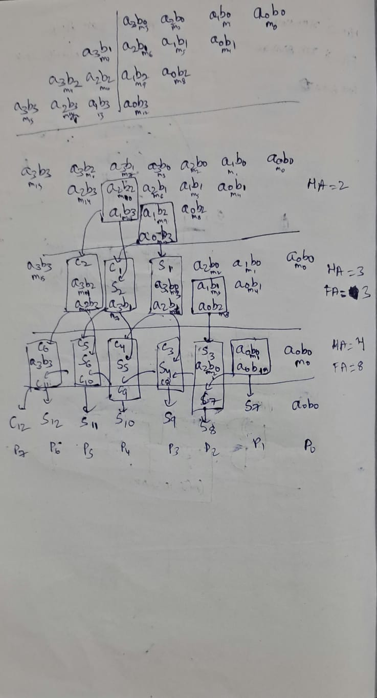
The sheet above shows the partial product matrix and how it is reduced layer by layer.
Theory:
The top of the sheet lists the 16 partial products arranged by bit weight. The columns hold 1, 2, 3, 4, 3, 2 and 1 bits, so the tallest column has 4 bits.
Each reduction layer groups bits of the same weight into HA (2 inputs) or FA (3 inputs) boxes. The sum output stays in the same column and the carry output moves to the next column.
The reduction is repeated until each column has at most 2 bits, and the last layer produces the final 8-bit result.
The running count written on the right of the sheet gives the adder budget: 4 half adders and 8 full adders in total.
The outputs `P0` to `P7` are taken as: `P0 = m0`, `P1 = S7`, `P2 = S8`, `P3 = S9`, `P4 = S10`, `P5 = S11`, `P6 = S12`, `P7 = C12`.
---
3. Manual Design (Wiring Plan)
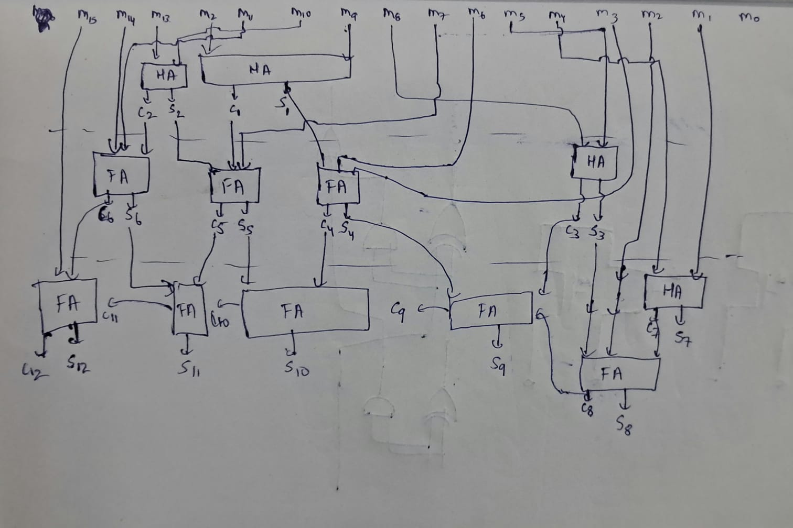
Theory:
This drawing converts the algorithm into a connection plan before drawing the schematic. The partial products `m0` to `m15` enter from the top. Each HA/FA block is labelled with its sum (`S`) and carry (`C`) outputs, numbered so that every signal can be traced into the next layer.
Top layer: half adders compress the 3- and 4-bit columns of the middle weights.
Middle layer: full adders combine the sums and carries from the top layer with the remaining partial products.
Bottom layer: the final full adders combine the remaining two rows, with the carry passing from one weight to the next (`C9 → C10 → C11 → C12`) until the product bits `S9` to `S12` and `C12` are produced.
Carries always move one column to the left (to the next higher weight), which is why `C12` becomes `P7`.
Writing this plan first is what made the large `mult` schematic manageable, since each net in the schematic matches a label here.
---
4. Basic Gates (Transistor Level)
All gates use W = 120 nm and L = 100 nm devices from `gpdk090_nmos1v` and `gpdk090_pmos1v`.
4.1 Inverter
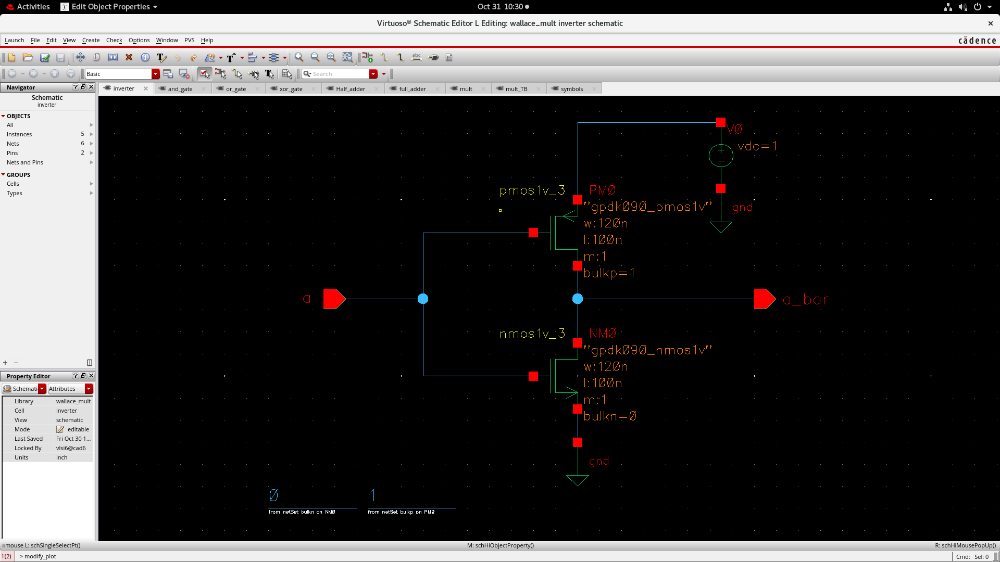
Theory: A CMOS inverter has one PMOS pull-up and one NMOS pull-down with gates tied together as the input. When the input is `0`, the PMOS conducts and the output is pulled to VDD. When the input is `1`, the NMOS conducts and the output is pulled to ground. Only one transistor conducts in steady state, so static power is almost zero. The inverter is also used inside the other gates to generate complemented signals.
4.2 AND Gate
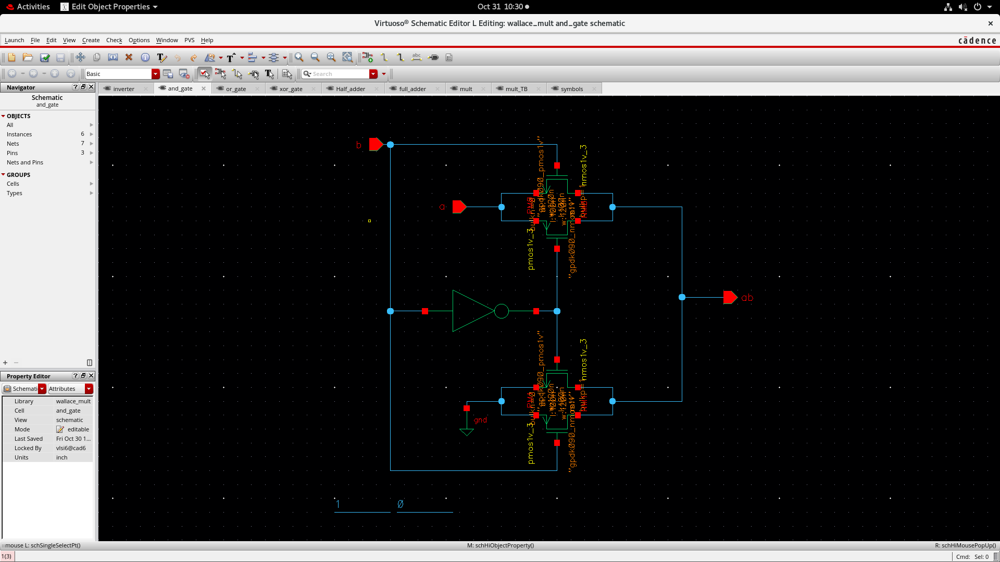
Theory: The AND gate is built from transmission gates (a parallel NMOS and PMOS pair) together with an inverter. One input is used as the select signal. When `b = 1`, the first transmission gate passes `a` to the output, so `out = a`. When `b = 0`, the second transmission gate connects the output to ground, so `out = 0`. This gives `ab = a · b`. Sixteen of these gates form the partial product array.
4.3 OR Gate
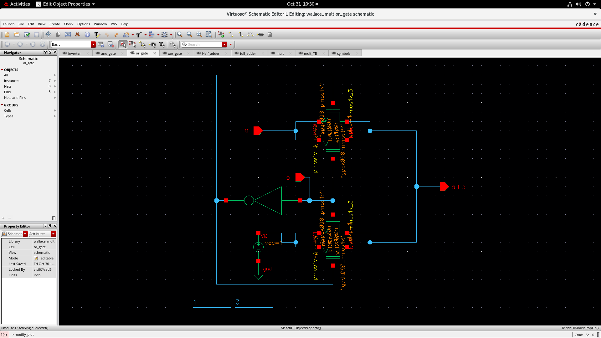
Theory: The OR gate uses the same transmission-gate idea. When `b = 0`, the output follows `a`. When `b = 1`, the output is connected to VDD (logic 1). This gives `a + b`. An inverter generates the complement of the select signal for the transmission gates. The OR gate is used to combine the two carries in the full adder.
4.4 XOR Gate
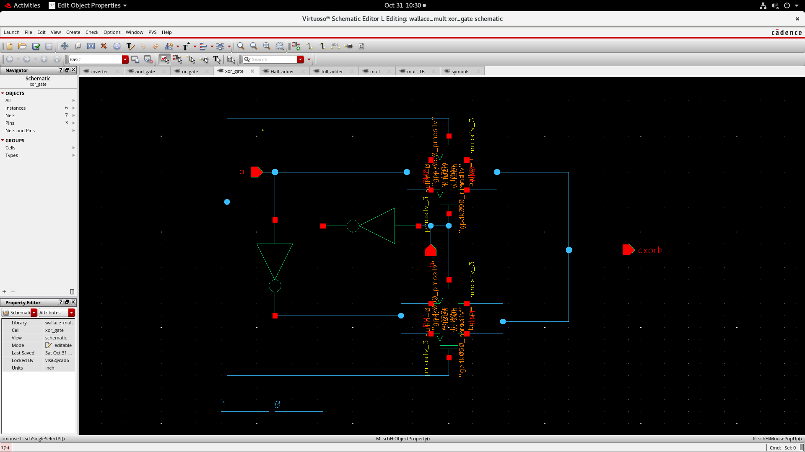
Theory: The XOR output is `a ⊕ b = a·b' + a'·b`. It is built with transmission gates and inverters: one signal is used to select whether the output follows the other input directly or its complement. XOR is the core of the adder, because the sum of two bits is exactly their XOR.
---
5. Adders
5.1 Half Adder
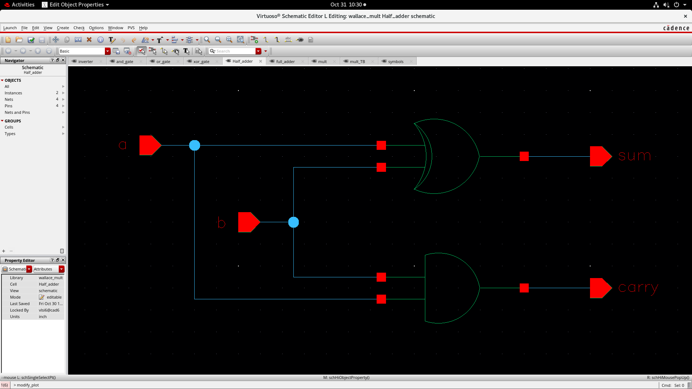
Theory: A half adder adds two 1-bit numbers and has no carry input.
```
sum   = a ⊕ b
carry = a · b
```
It is built from one XOR gate and one AND gate.
a	b	sum	carry
0	0	0	0
0	1	1	0
1	0	1	0
1	1	0	1
5.2 Full Adder
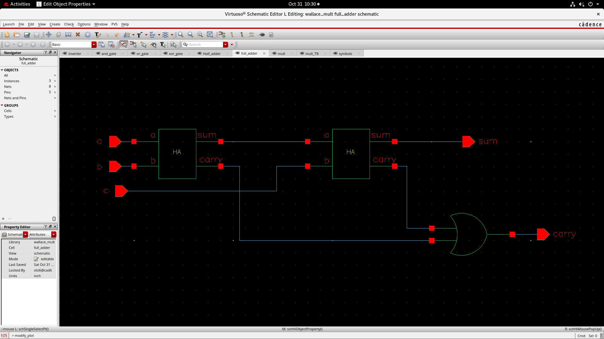
Theory: A full adder adds three 1-bit numbers (`a`, `b` and carry-in `c`).
```
sum   = a ⊕ b ⊕ c
carry = a·b + c·(a ⊕ b)
```
It is made from two half adders and one OR gate. The first HA adds `a` and `b`; the second HA adds that sum to `c`; the two HA carries are ORed to give the final carry.
a	b	c	sum	carry
0	0	0	0	0
0	0	1	1	0
0	1	0	1	0
0	1	1	0	1
1	0	0	1	0
1	0	1	0	1
1	1	0	0	1
1	1	1	1	1
---
6. Top-Level Multiplier
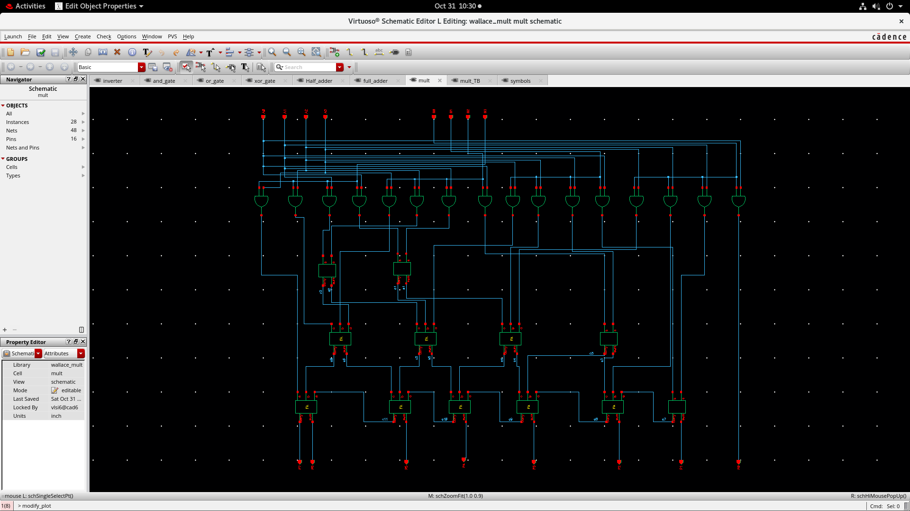
Theory: This is the full 4-bit Wallace tree multiplier. The structure follows the manual design directly:
Top row: 16 AND gates generate the partial products `m0` to `m15` from inputs `A0–A3` and `B0–B3`.
Middle: half adders and full adders reduce the partial products layer by layer.
Bottom: the last layer of full adders produces the upper product bits.
Outputs: `P0` to `P7` form the 8-bit result.
The schematic has 28 instances (16 AND gates, 4 HAs and 8 FAs), 16 pins and 48 nets, matching the plan in the algorithm sheet.
Symbols

Each cell has a custom symbol so it can be used hierarchically: inverter, AND, OR, XOR, HA, FA, and the 4-bit multiplier block with inputs `A0–A3`, `B0–B3` and outputs `P0–P7`.
---
7. Testbench and Simulation
7.1 Testbench
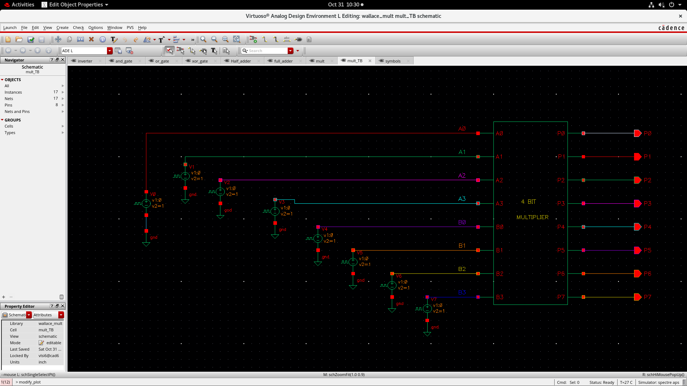
Theory: The testbench `mult_TB` instantiates the multiplier symbol and drives each input (`A0–A3`, `B0–B3`) with a pulse voltage source (`v1 = 0 V`, `v2 = 1 V`). Each output `P0–P7` is connected to an output pin for probing. A transient analysis (0 to 100 ns) is run in ADE L with the Spectre simulator at 27 °C.
7.2 Input Waveforms
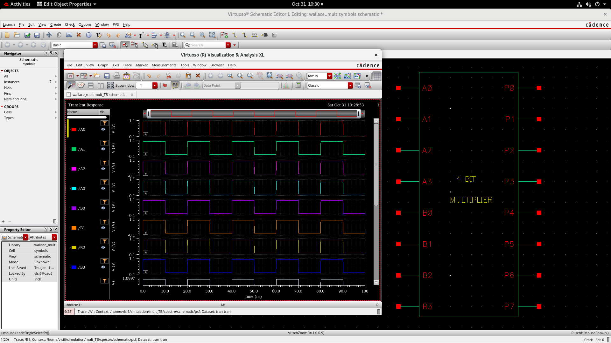
Theory: The eight inputs switch between 0 V and 1 V (logic 0 and logic 1). In this run all inputs are driven by the same pulse, so the operands alternate between `0000` and `1111`.
7.3 Output Waveforms

Theory: With `A = B = 1111`, the expected product is `15 × 15 = 225 = 1110_0001`. The waveform matches this:
Inputs	P7 P6 P5 P4 P3 P2 P1 P0	Decimal
A = 0000, B = 0000	0 0 0 0 0 0 0 0	0
A = 1111, B = 1111	1 1 1 0 0 0 0 1	225
`P0`, `P5`, `P6` and `P7` swing to logic 1 when the inputs are high.
`P1` to `P4` stay at logic 0 apart from short spikes at the switching instants. These are glitches caused by unequal path delays through the adder tree when many inputs change at once. They settle back to 0 before the next transition.
---
8. Layout

Theory: The layout was drawn in Virtuoso Layout Suite XL for the gpdk090 process. Standard CMOS layout layers are used: Nwell, Poly, Pimp/Nimp diffusion, Contacts, and Metal1 onward for routing, with vias between metal layers. Transistors for each gate are placed in rows, with PMOS in n-well regions and NMOS in the substrate, and supply rails shared between neighbouring cells. Signals are routed on Metal1/Metal2 and above.
Verification status: [update with your DRC / LVS / post-layout simulation results here.]
---
9. Repository Structure
```
.
├── README.md
├── LICENSE
├── docs/
│   ├── algorithm.jpeg
│   └── manual_design.jpeg
├── schematics/
│   ├── inverter.png
│   ├── and_gate.png
│   ├── or_gate.png
│   ├── xor_gate.png
│   ├── half_adder.png
│   ├── full_adder.png
│   ├── mult_top.png
│   ├── mult_tb.png
│   └── symbols.png
├── simulation/
│   ├── transient_inputs.png
│   └── transient_outputs.png
└── layout/
    └── mult_lay.png
```
10. How to Reproduce
Create a Virtuoso library attached to the gpdk090 technology.
Draw the `inverter`, `and_gate`, `or_gate` and `xor_gate` schematics (W = 120 nm, L = 100 nm).
Create symbols and build `Half_adder`, then `full_adder`.
Build the `mult` schematic using the connection plan in `docs/manual_design.jpeg`.
Create `mult_TB` with pulse sources on A and B and run a 100 ns transient simulation in ADE L (Spectre).
Draw the layout (`mult_lay`) and run DRC and LVS.
11. Future Work
Test with more input combinations (for example, 7 × 9, 12 × 5, 15 × 1) and compare with expected products.
Measure propagation delay, power and area.
Run post-layout (extracted) simulation.
Compare against an array multiplier.
License
Released under the MIT License. See LICENSE.
Author
Manoj Kumar
Dual Degree (B.Tech + M.Tech), Electronics and Communication Engineering
IIITDM Kurnool
